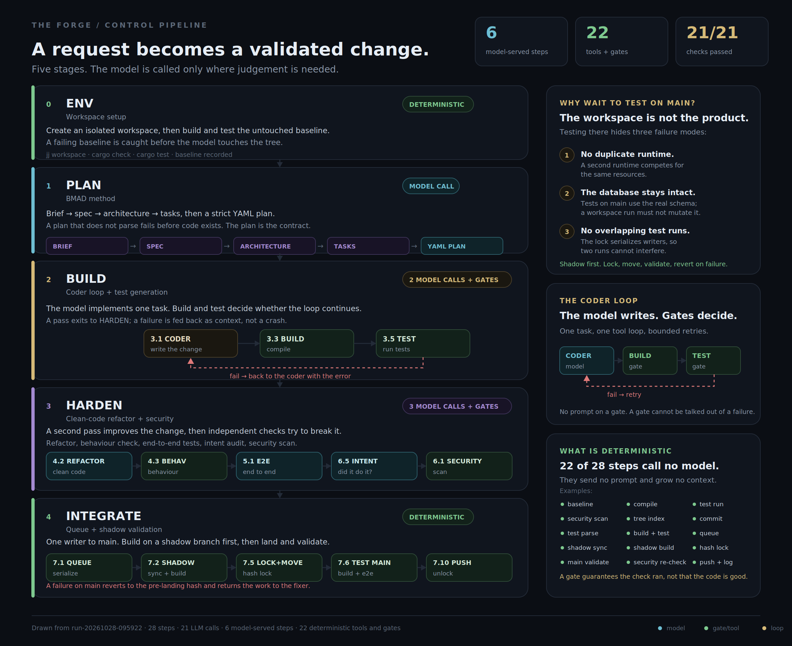
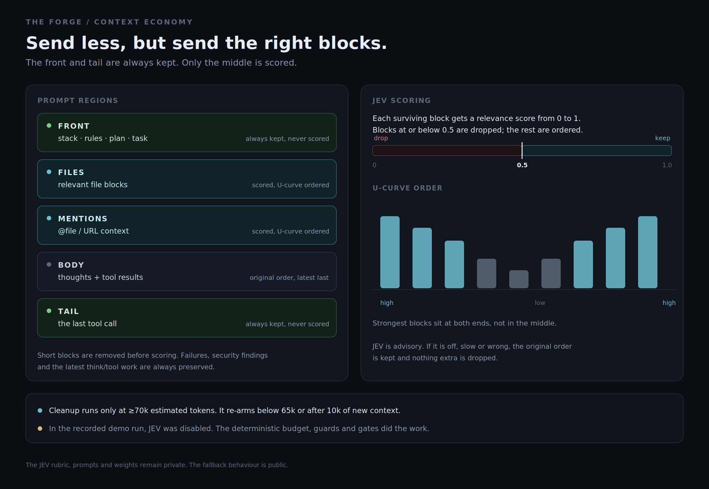
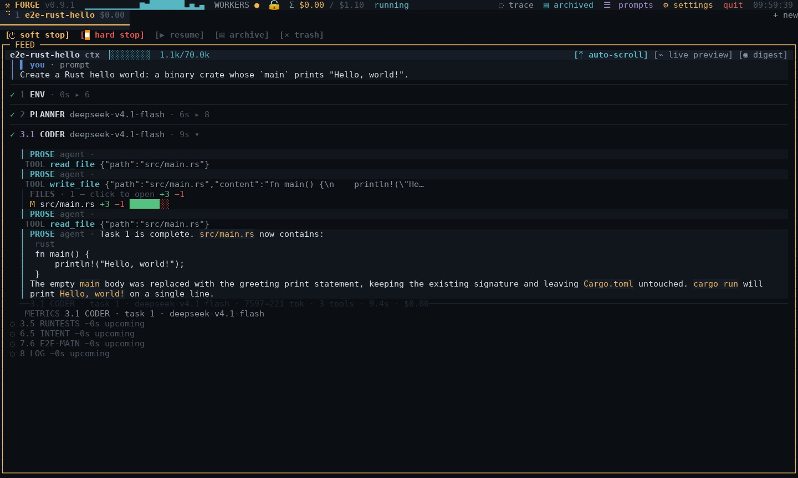

<h1 align="center">THE FORGE</h1>

<p align="center"><strong>A working system for controlled code generation.</strong><br>
This repository is a public slice: architecture, control slice, and a real unattended run.</p>

<p align="center">
  <a href="#demo"></a>
  <a href="#evidence"></a>
  <a href="#code-slice"></a>
  <a href="#limits-and-status"></a>
  <a href="#license-and-source-access"></a>
</p>

<p align="center">
  <a href="#what-this-is">What this is</a> ·
  <a href="#what-this-demonstrates">What this demonstrates</a> ·
  <a href="#pipeline">Pipeline</a> ·
  <a href="#built-for-parallel-feature-work">Parallel feature work</a> ·
  <a href="#architect-workflow">Architect workflow</a> ·
  <a href="#context-not-persona">Context, not persona</a> ·
  <a href="#where-the-leverage-is">Context &amp; JEV</a> ·
  <a href="#research-basis">Research</a> ·
  <a href="#demo">Demo</a> ·
  <a href="#evidence">Evidence</a> ·
  <a href="#code-slice">Code</a> ·
  <a href="#limits-and-status">Limits</a>
</p>

---

<p align="center">
  <a href="assets/pipeline.svg"></a>
</p>

---

**Start here:** the pipeline above, then the [demo](#demo), then the [code slice](#code-slice). Run `bun run example` to see the env-to-plan-to-build-to-harden handoff and one tool call. The [limits](#limits-and-status) are part of the public slice.

## What this is

**The Forge is a working system; this repository is its public slice.** It publishes the architecture, the safe parts of the control layer, and a real run. The tuned control policies, the integration machinery and the evaluation corpus remain private. Prompts are not the moat; the control plane is.

The public pipeline is a **reduced demo pipeline**, not the full step table: the major stages plus one deterministic stage, enough to show the model/deterministic split. The full pipeline has more deterministic steps, more gates and a landing path that stays private.

The model is an unreliable component inside a larger control system. The engineering is what happens around it: what context it sees and when it is pruned; when a loop may continue and when it must stop; which output shapes are accepted and how malformed output is repaired; how a change is validated before `main`; and how a failure is reverted instead of rationalised.

### What it is not

- **Not a product.** Single-operator system, no multi-tenant story.
- **Not a framework.** The pipeline is opinionated and the steps are fixed.
- **Not open source.** The architecture and selected code are published; the tuned engine is private.
- **Not the whole system.** This repository is a public slice. The engine is larger, and not every part of it is finished. See [Limits and status](#limits-and-status).

---

## What this demonstrates

The project is a demonstration in three layers.

**1. LLM engineering knowledge.** Context is a budget, not a transcript. The system compresses files into a multi-level map, scores blocks, orders them against the U-curve, and prunes with hysteresis. It treats model output as a contract that must parse, bounds the tool loop with deterministic guards, and uses a cheap sidecar (JEV) only for small judgement calls. The [code slice](#code-slice) makes the control boundary and the guards inspectable; the production control policies, the scorer and the integration machinery stay private.

**2. A development workflow.** The pipeline is the workflow: environment and baseline, a BMAD-style plan, a coder loop with build and test, a clean-code and security pass, then queued integration with shadow validation on `main`. Each stage has a declared input, output and gate. The model is called only where judgement is needed; the rest is deterministic tooling.

**3. An architect workflow.** The user is not prompting for snippets. The user defines the repository structure, the stack, the libraries, the interfaces, the tests and the definition of done. The Forge executes that design and enforces the process. This is the part most agent tools leave implicit, and the part that determines whether the result is maintainable six months later.

The distinction is worth naming. The previous method is **prompting**: you write and tune instructions, then hope the model behaves. This is **pipeline control**: you define what each step receives, what it must emit, which gate accepts it, and how the result lands. The model is one component; the control plane is the system.

---

## Pipeline

A request becomes a validated change through five stages:

**0 · ENV — workspace setup.** Create an isolated workspace, then build and test the untouched baseline before the model touches the tree.

**1 · PLAN — BMAD (Breakthrough Method for Agile AI-Driven Development).** The planner works through brief, specification, architecture and tasks, then emits a strict YAML plan. A plan that does not parse fails before code exists; the plan is the contract.

**2 · BUILD — coder loop.** The model implements one task inside one tool loop. Compile and tests run after each change; a failure is fed back as context, not raised as a crash. Retries are bounded.

**3 · HARDEN — clean code and security.** A second model pass refactors for structure and clarity, then independent checks try to break the change: behaviour, end-to-end tests, intent audit and security scan.

**4 · INTEGRATE — queue and shadow validation.** Work waits in a queue; only the head may take the lock. The change is shadow-built first, then moved to `main`, validated again, and reverted if validation fails.

### The deterministic majority

The pipeline looks large because it is a pipeline, not one agent. In the recorded run, **only 6 of 28 steps were model-served**, and those six made **21 LLM calls in total**. The other 22 steps are deterministic tools and gates, listed in the table below.

That split is the cost and context argument: a deterministic step sends no prompt, grows no context, produces a fact the next step can check, and cannot be talked out of a failure by a persuasive model.

Deterministic steps do not guarantee correct code. They guarantee that the check ran and that a failure cannot silently pass. The model is used where judgement is needed: plan, code, tests, refactor, end-to-end tests, and intent audit. This is also the lesson of [Agentless](https://arxiv.org/abs/2407.01489): a structured pipeline can outperform a more elaborate agent loop on real repository work.

The public slice mirrors the handoff, not the full engine: [`code/pipeline.ts`](code/pipeline.ts) runs env, plan, build and harden by default and declares integrate; a passing plan is applied to `state.plan` and `state.currentTask`, the build gate records the workspace diff and test output, and each step gets its own context budget and tool allowlist. ENV is the deterministic stage that shows the runner before the model is called. INTEGRATE is a declaration only; the queue, lock, shadow build and revert stay private.

| Phase | Steps in the run | Model-served steps | Deterministic tools and gates |
|---|---:|---:|---|
| **Plan** | 3 | 1 | baseline, orchestration |
| **Build** | 7 | 2 | security, compile, run tests, index, commit |
| **Harden** | 10 | 3 | test parsing, behaviour check, build and test, fragtree, two commits, pentest |
| **Integrate** | 7 | 0 | queue, shadow sync, shadow build, lock, main validation, security re-check, push |
| **Log** | 1 | 0 | trace and digest |

A model-served step can make more than one LLM call. The table counts steps, not calls; the run made 21 calls across the six.

### Why integration waits for `main`

A change that passes in the workspace is not yet a change that can be trusted on `main`. Testing inside the live workspace hides three failure modes:

1. **No duplicate runtime.** The workspace is already busy; a second runtime would compete for CPU, ports and file handles.
2. **The database stays intact.** Tests on `main` run against the real schema, which a workspace run must not mutate.
3. **No overlapping test runs.** The lock serialises writers, so two runs cannot interfere with each other's tests; the second waits.

The integration path is `queue → shadow sync → shadow build → lock + move → validate main → revert on failure → fix → re-audit → push + unlock`. The change is shadow-built before `main` is touched; the lock records the expected `main` hash and rejects the move if `main` has moved; validation runs after the move; any failure reverts to the pre-landing hash and returns the work to the fixer; a post-move security finding also reverts unless a human approves.

The goal is not "never fail". It is "a failure never becomes the new baseline".

Retry budgets are bounded at every stage, with a 30-minute cap per step. These are guard rails, not a promise that every run converges.

---

## Built for parallel feature work

The unit of work is a feature or change inside an existing codebase, not a one-off snippet. The tool is designed for several same-field changes in flight at once. A frontend example: one session builds the auth panel — 2FA, OAuth, password recovery, provider integrations — while another builds chat — edit, send, delete, presence. They share the same stack, structure and conventions, run concurrently, and the integration queue merges them without one landing corrupting the other.

The pipeline is shaped for that workload: bounded tasks, isolated workspaces, serialized integration, shadow builds, and revert on failure. It is not shaped for one-line edits.

**Simple tasks are the weak point.** A hello world does not need a baseline, a plan, a hardening pass or a shadow build. There is a simple path for changes that small, but the e2e test does not use it: the test deliberately runs the full pipeline so every step is exercised and its issues surface. That is why the demo looks heavier than the task.

**Very hard goals work, but not in one shot.** The tool will do them; it will not do them efficiently as a single session. Create the foundation first — structure, interfaces, build, tests — then build the features around it in multiple sessions. Each session gets a bounded task against a stable base, and the queue merges the results. This is the intended shape of a large project.

**The trade is speed for parallel safety.** The Forge is slower than a direct agent on a single small task: it builds a baseline, writes a plan, runs a coder loop, hardens, queues, shadow-builds, locks `main`, validates, and only then lands. In return, several features can be in flight without fighting over the same workspace, database or test process; integration is serialised; a failed validation reverts instead of becoming the baseline; and cost and context stay bounded.

It behaves like a lead developer: you define the work, the structure and the standard; the pipeline executes, checks and reports. You spend time on the idea and the final result, not the mechanical act of coding.

That is the productivity claim: **not faster per task, but safer in parallel, and cheaper in attention.**

The queue and lock are implemented; a concurrent-session stress test is the next test. See [Limits and status](#limits-and-status).

---

## Architect workflow

Most coding tools are designed around a prompt: you describe the change, the model writes it, you review the diff. That is a good fit for a quick edit. It is a poor fit for a system you intend to keep.

The Forge pushes the work back to the architect:

- **You own the file structure.** The model works inside the layout you declared, not a layout it invents.
- **You own the file contents.** Existing modules, interfaces and conventions are part of the design, not optional context.
- **You own the stack and libraries.** The tool does not choose a framework for you, and it does not silently add dependencies.
- **You own the definition of done.** The plan, the tests and the gates encode what "finished" means.

| | Direct agent (Claude Code, Cursor, Copilot) | The Forge |
|---|---|---|
| Optimises for | Fast local edits and inline suggestions | A controlled, validated change |
| You supply | A prompt | Structure, stack, libraries, interfaces, done criteria |
| The model does | Writes most of the code | Implements a declared task |
| Quality comes from | The prompt and the model | Contracts, gates, tests, audits, revert |
| Parallel work | Collides on files, runtime, database | Queued, locked, shadow-built |
| Your role | Prompt author and reviewer | Architect and operator |

These are good tools for a different job. A direct agent encourages you to keep asking for the next piece; the Forge encourages you to invest in structure, standards and the long-term result. Your time goes to the idea and the architecture, not to typing code.

Full control remains with you: the stack, the file layout, the gates, the merge policy and the final review.

---

## Context, not persona

There is a trend toward writing one long prompt that turns the model into a "specialist": who it is, why it exists, how it "lives inside a computer". That is not how this pipeline works.

The step already knows its job. What it needs is the right context and a clear task: the stack, the plan, the files, the interfaces, the tests, the definition of done. Persona text does not help with the work. It consumes context, adds noise, and can push the model toward unexpected behaviour.

Custom prompts here are instructions, not context. They tell a step what to do. The pipeline supplies the state the step needs to do it. That division is deliberate: the context budget is spent on the repository and the task, not on a character sheet.

---

## Where the leverage is

### 1. Context economy

The prompt is assembled from regions:

[](assets/context.svg)

```text
front     stack, rules, plan, task        always kept, never scored
files     relevant file blocks            scored, U-curve ordered
mentions  @file / URL context             scored, U-curve ordered
body      thoughts and tool results       original order, latest work last
tail      the last tool call              always kept, never scored
```

Three mechanisms do most of the work:

- **Compression before assembly.** `FRAGTREE` builds a file-by-file map at several levels of detail (LOD 1–7), so the model can navigate without reading every file. This implements the [Stingy Context / TREEFRAG](https://arxiv.org/abs/2601.19929) idea. Raw source is a choice, not the default; compression can preserve task performance while reducing cost ([LLMLingua](https://arxiv.org/abs/2310.05736), [LongLLMLingua](https://arxiv.org/abs/2310.06839)).
- **Cheap filtering before scoring.** Empty blocks, acknowledgements (`ok`, `sure`, `…`) and thoughts under 16 non-space characters are removed before they cost a scoring question or a token. Failures, security findings, file blocks and the latest work are always kept.
- **Hysteresis, not constant cleanup.** Cleanup runs only when the next prompt is estimated at or above **70k tokens**, and re-arms below **65k** or after **10k** of new context. If scoring is unavailable, the original order is preserved and nothing extra is dropped.

Blocks are sorted by score and dealt alternately to the two ends, so the strongest sit at the start and the end and the weakest in the middle, where attention is weakest:

```text
high → … → low → … → high
```

That ordering follows the position effects reported in [Lost in the Middle](https://arxiv.org/abs/2307.03172) and the positional calibration work in [Found in the Middle](https://arxiv.org/abs/2406.16008). The public slice shows where context is chosen: [`code/pipeline-context.ts`](code/pipeline-context.ts) budgets each step and records what was kept or dropped. The production scorer, its U-curve implementation and the hysteresis tuning stay in the private engine.

### 2. JEV, in plain terms

**JEV** is an optional, cheap LLM sidecar. It answers small `score` / `choice` / `noul` questions so the machine can pick among paths it already has. It is **not a step and not a detector**: it writes no code, chooses no step, and overrides no gate.

JEV is used for context cleanup (at or above 70k tokens it scores each surviving block; blocks at or below **0.5** are dropped and the rest are U-curve ordered), event importance (display-only; it never suppresses a failure), and ask batching (implemented; planner-subagent triggers are gated off pending calibration). Front, tail, file blocks, hard failures and the latest work are always kept.

What it is not:

- **Not allowed to suppress a deterministic check.** A low JEV score can drop a low-relevance block or keep a routine event out of the digest; it cannot hide a failed build, a security finding or a failed test.
- **Not required.** If JEV is off, slow or returns malformed output, the pipeline keeps the original order and drops nothing extra.

In the recorded demo run, **JEV was disabled** (`jev.enabled: false`). The context budget, short-block filter, hysteresis and loop guards are deterministic; they did the work without a sidecar. The public demo should not depend on an optional scoring service. The JEV rubric, prompts and weights remain private; the interface and fallback behaviour are public in [`code/jev.ts`](code/jev.ts).

### 3. Output contracts and repair

Every structured step has a parser and a bounded repair path:

- **Plans are strict structured output**, not prose. A plan that does not parse is a failure, not something the next step guesses around. This exists because a thinking-enabled planner once spent its entire 32k output budget on a reasoning block and emitted `YAML error: empty response`. The engine parses YAML; the public slice uses JSON for the same boundary.
- **Tool arguments are JSON-schema checked** before execution. A malformed call becomes a failed `ToolResult`, never an exception that kills the session. The public tool boundary applies the same rule in [`code/agent-tools.ts`](code/agent-tools.ts).
- **Tests are generated before the run is trusted.** The test generator writes real files; a missing test file is a task retry, not a silent pass.
- **The plan is a contract, and intent is audited separately.** The contract checker compares declared files and modules against what was touched; a read-only join between plan criteria and test coverage catches "it compiles, but it did not do what was asked."
- **Partial work is committed.** A capped or retried step keeps what is on disk; the pipeline does not throw away a working tree because one step ran out of turns.

Self-correction is useful, but not a substitute for a check that can fail. [LLMs correcting their own reasoning](https://arxiv.org/abs/2310.01798) is a reason to put deterministic gates and human review around the model, not to ask it to grade itself.

### 4. Loop guards

One loop is easy to write and hard to keep bounded. The runner has deterministic guards, and each guard **nudges before it aborts** — the notice is injected as a tool result so the model actually reads it.

| Guard | Nudge after | What it catches |
|---|---:|---|
| Identical call (same tool, same arguments) | 4 calls | Re-reading or re-writing the same thing |
| Same command family | 5 calls | `cargo test`, `cargo test --offline`, `cd /w && cargo test \| tail` |
| No progress (all calls failed, nothing written) | 2 turns | A model stuck in an error loop |
| Same file rewritten | 3 rewrites | Thrashing on one file |

The exact abort thresholds are in [`code/loop-guards.ts`](code/loop-guards.ts); the table shows when the first nudge fires. [`code/agent-turn.ts`](code/agent-turn.ts) collects the notice, and [`code/agent-loop.ts`](code/agent-loop.ts) injects it as a tool result.

`commandFamily` normalises flags, paths, `cd` prefixes, pipes and environment assignments, so a model cannot evade the counter by changing the shape of the same command. The guard exists because a real run repeated `cargo test` in three different shapes; the exact-argument counter saw three different calls.

---

## Research basis

These papers inform the design. They are not benchmarks of The Forge, and none of them establishes that this particular pipeline works.

| Design choice | Research | What it supports |
|---|---|---|
| Planner structure | [BMAD Method](https://github.com/bmad-code-org/BMAD-METHOD/) · [BMAD docs](https://docs.bmad-method.org/) | Brief, spec, architecture and tasks before code; the plan is a reviewable contract. |
| Hierarchical context compression | [Stingy Context / TREEFRAG](https://arxiv.org/abs/2601.19929) | Multi-level file maps let the model navigate without reading everything; `FRAGTREE` builds them. |
| U-curve context ordering | [Lost in the Middle](https://arxiv.org/abs/2307.03172) · [Found in the Middle](https://arxiv.org/abs/2406.16008) | Models use the start and end of long contexts better than the middle. |
| Compression and filtering | [LLMLingua](https://arxiv.org/abs/2310.05736) · [LongLLMLingua](https://arxiv.org/abs/2310.06839) | Compression can reduce cost while preserving task performance. |
| One reason/act loop | [ReAct](https://arxiv.org/abs/2210.03629) | Interleaving reasoning and tool actions is a strong baseline; one loop is easier to bound. |
| Bounded reflection | [Reflexion](https://arxiv.org/abs/2303.11366) | Verbal feedback can improve retries; reserve it for repair moments. |
| Sampling and variance | [Self-Consistency](https://arxiv.org/abs/2203.11171) | Samples help when several paths are plausible; they hurt structured output. |
| Limits of self-correction | [LLMs Cannot Self-Correct Reasoning Yet](https://arxiv.org/abs/2310.01798) | Self-correction alone is unreliable; use deterministic checks and human review. |
| Deterministic pipelines | [Agentless](https://arxiv.org/abs/2407.01489) | Simple, structured pipelines can outperform complex agent loops on real repository tasks. |
| Evaluation and tooling | [SWE-bench](https://arxiv.org/abs/2310.06770) · [SWE-agent](https://arxiv.org/abs/2405.15793) | Real-world tasks are the right stress test, and the agent-computer interface matters. |

The design also borrows from chain-of-thought and deliberate reasoning work, but thinking is a global provider flag today, not a per-step policy. That gap is listed in [Limits and status](#limits-and-status).

---

## Demo

[](demo/run.mp4)

A raw TUI capture, cut between the major steps. No overlays, no animation, no re-enactment. The frames come from the run's own event log; absolute paths are redacted and the clock is restored to the captured frame time.

Shown: `1 ENV → 2 PLANNER → 3.1 CODER → 3.5 RUNTESTS → 6.5 INTENT → 7.6 E2E-MAIN → 8 LOG`. The frames between them are cut; the run itself executed all 28 steps.

[MP4](demo/run.mp4) · [GIF](demo/run.gif) · [Poster](demo/poster.jpg)

This is a full-pipeline run on a deliberately small task — a Rust hello world. It is a machinery test, not a speed or cost benchmark. The simple path would normally handle a task this small; the e2e test runs the full path on purpose so every step is exercised and its issues surface.

JEV was disabled in this run (`jev.enabled: false`).

> **Mechanical evidence, not a quality benchmark.** This run shows that the pipeline can plan, build, test, refactor, audit, merge and validate without a human. It does not show that the system writes good code for hard problems. During the build phase, the end-to-end tests are bug-finding instruments, not a quality score. See [Build-phase testing](#build-phase-testing).

---

## Evidence

### Mechanical evidence

| Run | Task | Result | Time | Cost | LLM calls | Checks |
|---|---|---|---:|---:|---:|---:|
| Full pipeline | Rust hello world, `new_feature` | merged to `main` | 80s | $0.0065 | 21 | 21/21 |
| Simple path | Rust hello world, `fix_bug` | merged to `main` | 48s | $0.0054 | 12 | 27/27 |

The rows use different check sets, so 21/21 and 27/27 are not directly comparable. Time and cost are for reproducibility, not a productivity benchmark.

The full run used `deepseek-v4.1-flash` for every tier, thinking disabled: 21 LLM calls across 6 model-served steps, 27 tool calls, 13 commands, 2 files, 1 commit. The other 22 steps were deterministic; the simple path skipped the planner.

**What the checks are.** The 21/21 checks are the run harness's own checks, not an independent benchmark, and they are not reproducible from this repository. The 47 unit tests in [`code/`](code/) are the reproducible part. The full-run checks cover terminal status, unanswered asks, implementation in the main checkout, commits, build and tests, failed steps, error toasts, spend and time ceilings, TUI state, global config, write confinement, contract drift, and baseline comparison.

### Build-phase testing

End-to-end tests in this repository are **not a quality benchmark**. During the build phase they are bug-finding instruments: they exercise the built artifact, expose integration mistakes, and give the loop something concrete to fix. They are useful precisely because they can fail.

A separate 25-hidden-test sample exists, but it is small and had mixed merge outcomes. It cannot support a quality claim, so it is not presented as one. The demo claims mechanics — that the pipeline runs, checks and lands — not that the model writes good code for hard problems. [SWE-bench](https://arxiv.org/abs/2310.06770) is a reminder that real repository tasks are a harder and more useful test than a toy task.

---

## Limits and status

**The Forge is a working system; this repository is its public slice.** The slice is not the full engine, and the engine is not finished. Known gaps:

- `4.3 BEHAV-CHECK` always passes; the mutation check is not implemented.
- `6.1 CVSS-SCAN` returns no deterministic findings; the scanner is a stub.
- The websearch subagent declares no tools and cannot actually search or fetch.
- RTK is wired but unconfigured; `rtk saved` is always 0. The wrapper borrows the command-output compression idea from [RTK](https://github.com/rtk-ai/rtk); no RTK binary is bundled or used here.
- The editor is a read-only preview with no insert, save or undo.
- Human-edit detection exists but is not wired; `--no-watch` currently changes nothing.
- The merge queue and lock have no concurrent-session stress test; this is the next test for the parallel-work claim.
- JEV auto-subagents are implemented but gated off pending calibration.
- Thinking and temperature are global provider settings, not per-step overrides.
- End-to-end tests are bug-finding tools in the build phase, not a quality benchmark.

What the demo does **not** show:

- that the system writes good code for hard problems;
- that two sessions contending for `main` behave correctly under stress;
- that every gate is implemented rather than inert;
- that the quality numbers generalise beyond the small sample.

The run exercises classify, plan, code, validate, test, refactor, audit, queue, shadow-build, lock, move, validate on `main`, and the push/unlock step; no remote was configured in the test repo, so no network push occurred. The failure path (revert, issue fix) is implemented but not exercised.

---

## Code slice

The public code is a **sanitised, runnable slice** of the control-plane shape, not the tuned engine, and its pipeline is a reduced demo of the full one. Each module has one job. Run [`example.ts`](code/example.ts) to see env → plan → build → harden with fake ports and one tool call; read [`agent-loop.ts`](code/agent-loop.ts) for the bounded model/tool loop and [`pipeline.ts`](code/pipeline.ts) for the step runner. The ports, turn execution, tool boundary, context selector, step table, parser, prompt renderer, tool policy and guards sit beside them. The tuned policies, the production gate implementations, the full step table and the integration machinery are private.

```text
.
├── README.md
├── LICENSE
├── NOTICE
├── package.json
├── bun.lock
├── tsconfig.json
├── .gitignore
├── .github/
│   └── workflows/
│       └── test.yml
├── assets/
│   ├── pipeline.svg / pipeline.png
│   └── context.svg / context.png
├── code/
│   ├── example.ts             # runnable env -> plan -> build -> harden example
│   ├── agent-loop.ts          # runAgent: the bounded model/tool loop
│   ├── agent-turn.ts          # one turn of tool calls, results and notices
│   ├── agent-tools.ts         # validate, execute and cap one tool call
│   ├── agent-loop-types.ts    # ports and loop types
│   ├── jev.ts                 # askJev, readers and batching
│   ├── jev-parse.ts           # payload validation
│   ├── jev-types.ts           # sidecar types
│   ├── pipeline.ts            # runPipeline: step orchestration
│   ├── pipeline-steps.ts      # env/plan/build/harden/integrate declarations (demo subset)
│   ├── pipeline-context.ts    # per-step context selection and manifests
│   ├── pipeline-prompt.ts     # prompt rendering
│   ├── pipeline-plan.ts       # plan parsing
│   ├── pipeline-tools.ts      # per-step tool allowlists
│   ├── pipeline-state.ts      # run state and plan handoff
│   ├── pipeline-types.ts      # pipeline types
│   ├── loop-guards.ts         # deterministic loop guards
│   ├── agent-loop.test.ts
│   ├── jev.test.ts
│   ├── pipeline.test.ts
│   └── loop-guards.test.ts
└── demo/
    ├── run.mp4
    ├── run.gif
    └── poster.jpg
```

Run the tests, typecheck and example from the repository root:

```bash
bun install
bun test code
bun run typecheck
bun run example
```

```text
47 pass
0 fail
155 expect() calls
```

`bun run example` wires fake ports, runs the deterministic env stage, makes one tool call, and prints the context each model step receives:

```text
ENV sees: (deterministic)
ENV gate: pass

PLAN sees: task, stack, repo-map
PLAN gate: pass

BUILD sees: task, files, criteria, repo-map
  tool: write_file
BUILD gate: pass

HARDEN sees: diff, tests, criteria
HARDEN gate: pass

pipeline: ok
plan task: Add TOTP verification
diff recorded: true
tests recorded: true
```

What is included:

- the bounded agent loop (`agent-loop.ts`), its per-turn tool execution (`agent-turn.ts`) and tool boundary (`agent-tools.ts`): the model as a port, tool calls as untrusted output, malformed-argument rejection, thrown-tool isolation, guard nudges injected as tool results, turn and deadline caps, and tool-result truncation;
- the JEV sidecar (`jev.ts`) and payload validation (`jev-parse.ts`): `score` / `choice` / `noul` validation, clamping, timeout and malformed-payload fallback, low-confidence choice fallback, and provider-sized batching;
- the pipeline (`pipeline.ts`) with step declarations (`pipeline-steps.ts`), per-step context selection and manifests (`pipeline-context.ts`), prompt rendering (`pipeline-prompt.ts`), plan parsing (`pipeline-plan.ts`), tool allowlists (`pipeline-tools.ts`) and run state (`pipeline-state.ts`): a deterministic env stage, required and optional budgeting, the plan-to-build state handoff, build gate observations, parse-and-gate handoffs, and a deterministic integrate step declared without its landing tool. The published table is a demo subset of the full one;
- loop guards (`loop-guards.ts`): command-family normalisation, repeat detection, no-progress detection, file-rewrite guards, and result signatures that include length and tail;
- tests for the control properties: a clean finish, a malformed call, a thrown tool, a guard nudge, a guard abort, the turn cap, truncation, JEV fallback, context manifests, allowlists, parse failure, gate failure, the plan-to-build handoff, a model error recorded as a failure, and the integrate declaration refusing to execute.

What is not included: the full step table and its tuned control policies, the integrate/landing tool and its queue, lock, shadow build and revert, the production context scorer and U-curve ordering, model routing, per-step retry tuning, the eval corpus, hidden tests, golden transcripts, prompts and prompt fragments, and the full agent implementations.

The slice makes the control-plane shape inspectable and falsifiable; it is not enough to reproduce the tuned control plane.

---

## License and source access

**All rights reserved.** Viewing and referencing this repository are permitted. Copying, modification, redistribution and commercial use are prohibited without written permission. See [`LICENSE`](LICENSE) and [`NOTICE`](NOTICE).

The private engine is available for **read-only source access on request**, subject to a short agreement. The public slice is enough to evaluate the design; it is not a substitute for the tuned control plane.

If you find a security issue, do not open a public issue with secrets or exploit details. Open a minimal issue asking for a private channel, or use the contact listed on the author's profile.
